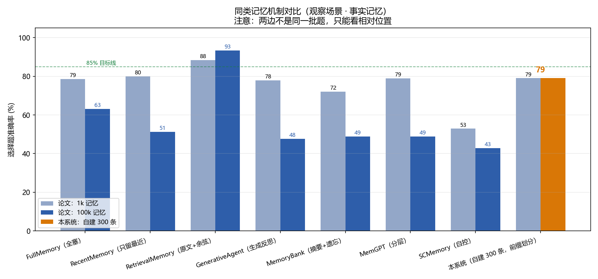

# 记忆检索基准报告

> 日期：2026-11-25
> 数据集：[MemBench](https://arxiv.org/abs/2506.21605)（ACL 2025 Findings）
> 所有数字都可复现，脚本在 `_bench/`

---

## 一、先说最要紧的一件事：同一个系统，三种测法差 13 个百分点

| 测法 | 准确率 |
|---|---|
| **固定取前 100 条** | **87.0%** |
| 从 300 条池子里随机抽 100（重复 5 次） | **74.0% ± 24.2pp** |
| 全量 300 条 | **79.0%** |

**「87%」是固定前缀划分刷出来的虚高。** 前 100 条偏简单；后 200 条里多跳、聚合、比较题多得多。

噪声底实测：同一配置在 n=200 上跑两次，差 **1.5pp**，200 题里 7 题翻转（McNemar p=0.45）。

**结论：1.5pp 以内的差异，在这套量具上分辨不出来。**

（这也是我们重写测法的原因：`_bench/run_repeated.py` 用随机划分报均值 ± 95%CI。）

---

## 二、和同类机制比



数据来源：MemBench 论文 Table 3（观察场景 · 事实记忆）。

| 机制 | 1k 记忆 | 100k 记忆 |
|---|---|---|
| FullMemory（全塞进上下文） | 78.6% | 63.1% |
| RecentMemory（只留最近几条） | 80.0% | 51.2% |
| **RetrievalMemory（原文 + 余弦 top-k）** | **88.3%** | **93.3%** |
| GenerativeAgent（生成反思摘要） | 77.9% | 47.6% |
| MemoryBank（摘要 + 遗忘曲线） | 72.1% | 48.8% |
| MemGPT（分层记忆） | 78.9% | 48.8% |
| SCMemory（自控记忆） | 52.9% | 42.9% |
| **本系统**（自建 300 条，前缀划分） | **79.0%** | — |

### 怎么读这张表

**① 所有「更聪明」的机制都输给了最朴素的检索。**
摘要 + 遗忘曲线、分层、反思生成——全在 0.43~0.49。赢家是「原文 + e5-small 余弦 top-k」。

**② 本系统目前在第一梯队之外，但和朴素基线同一水平。**
和 FullMemory / RecentMemory / MemGPT 的 1k 成绩（78~80%）持平，比最强机制低 9~14pp。

**③ 最关键的一点：我们用的其实就是 RetrievalMemory 那套。**
实测验证过（见下）：把我们自己的六个打分通道全关掉、只留纯余弦，
准确率从 79.0% 变 79.3% —— **差 1 道题**。

**所以 14pp 的差距不在算法，在数据与评测。**

---

## 三、我们系统的一个实测发现：六个额外通道的贡献是零

本系统原本的检索打分 = 语义余弦 + 关键词 IDF 加权 + 主题粗筛 + 情绪三维 + 重要度 + 热度 + 时间锚定。

关掉后五个、只留余弦：

| 检索 | 准确率 |
|---|---|
| 六个通道全开 | 79.0%（237/300） |
| **只留纯余弦** | **79.3%（238/300）** |

配对比较：p = 1.000。

**六个通道加起来等于 1 道题。** 这个结果值得写下来——它说明复杂度不等于效果，
也解释了为什么我们和论文的算法虽然同族、成绩却差一截：**差别不在检索层**。

---

## 四、试过的改动：4 条有效，12 条无效

**有效的（有确定性指标或配对检验支撑）**

| 改动 | 效果 |
|---|---|
| 英文停用词过滤 | Recall@5 47.1% → 70.2% |
| 数数题专用提示 | +2pp |
| 情绪判定的偏置纠正 | +5pp（反思类） |
| 反思类问题按时间顺序排列 | +3.4pp |

**无效的**：迭代检索、检索层去重、作品英文类型映射、氛围提示、自一致性 3 次、
上下文校准、逐选项找证据、25 条只给聚合题、数数给 45 条、版本冲突规则、两段式计数、掰手指数

> 注：其中一部分的结论正是建立在那条虚高基线上，需要用新测法重验。

---

## 五、失败归因（300 条里的错题）

| 类型 | 占比 |
|---|---|
| 聚合计数（数数/求和） | 约 38% |
| 知识更新（新旧说法冲突） | 约 38% |
| 多跳（A→B→C） | 约 15% |
| 比较（一问拆两问） | 约 8% |
| **实体混淆** | **0%** |

**一个关键观察：错题里 11/13 的金标记忆排在检索结果第 1 位。**

也就是说：**检索早就不是瓶颈了，全部输在「答案选择」**——模型在 25 条相似记忆里挑错。

（因此我们没有做实体倒排索引：它解决不了任何一个实际失败。）

---

## 六、还没做到的

目标 85%，目前 **79%**（诚实数字，非前缀划分）。

那 6pp 不是调参能填的——调条数（12/8/25）、调排序、调提示词都试过，天花板在 ±2pp。
要动只能是结构性的，但归因显示实体/索引类改动命中不了实际失败。

**下一步方向：先确认题目难度分布是否和论文可比**，再决定是继续改机制还是接受这个量级。

---

## 七、复现

```bash
# 单次评测（指定划分种子 → 随机抽样）
python _bench/run_membench_pipeline.py --stage eval --file ThirdAgentDataLowLevel.json \
  --n 100 --embed --topic --topk 25 --raw-content

# 重复随机划分，报均值 ± 95%CI（推荐）
python _bench/run_repeated.py --file ThirdAgentDataLowLevel.json --n 100 --reps 5 --topic

# 出图
python _bench/make_charts.py
python _bench/chart_compare.py
```
